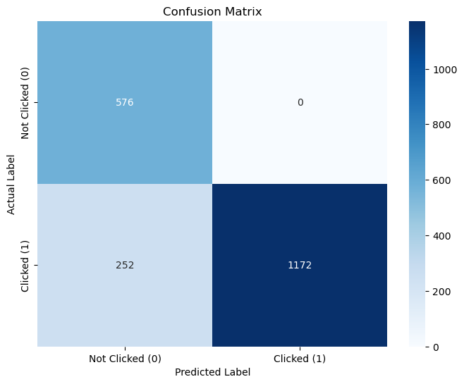
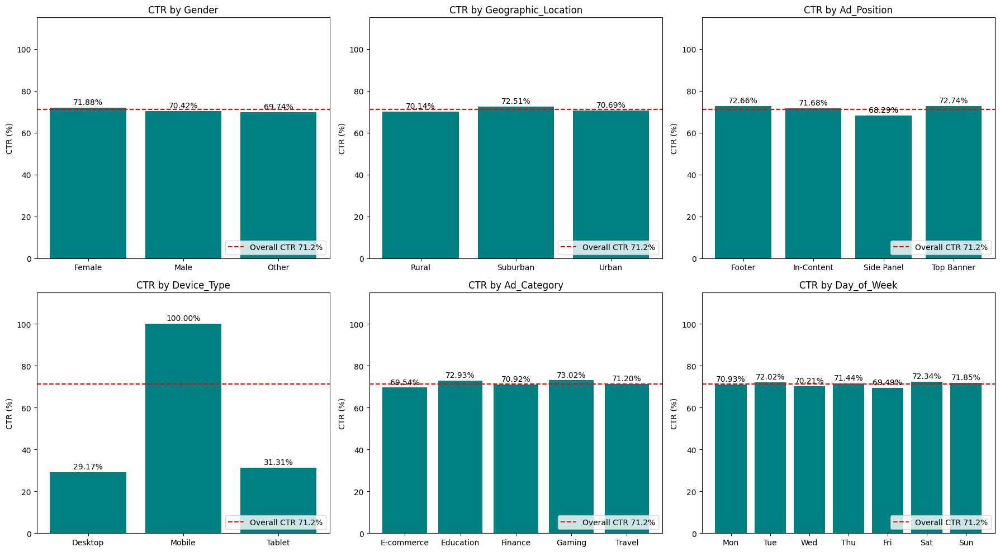

# Ad Click Prediction with Logistic Regression

Predicting whether a user will click an online ad, and finding out which factors drive clicks, using a scikit-learn Logistic Regression pipeline.

> **Heads-up on the data:** every Mobile impression in this dataset was clicked (5,901 of 5,901). Real ad traffic never behaves like that, so the dataset is probably synthetic or has a logging artifact. The model's accuracy comes almost entirely from this one pattern. See [Limitations](#limitations).

## Table of Contents

- [Business Problem](#business-problem)
- [Dataset](#dataset)
- [Approach](#approach)
- [Results](#results)
- [Key Findings](#key-findings)
- [Limitations](#limitations)
- [Repository Structure](#repository-structure)
- [Getting Started](#getting-started)
- [Tech Stack](#tech-stack)

## Business Problem

*AdVantage Analytics* is a programmatic advertising platform. Each impression that is not clicked is wasted spend for the advertiser, which hurts CTR, client satisfaction and platform revenue. The goal is a model that estimates the probability of a click **before** an ad is shown, so impressions can be prioritised.

Objectives:

1. Predict the probability that a user clicks an ad.
2. Identify the main drivers of clicks.
3. Choose a decision threshold for scoring and prioritising impressions.

## Dataset

10,000 ad impressions and 13 columns (`data/ad_click_data.csv`, not included). 71.2% of impressions were clicked.

| Group | Columns |
|---|---|
| User | `Age`, `Gender`, `Geographic_Location` (Urban/Suburban/Rural), `Time_Spent_on_Site`, `Previous_Clicks` |
| Ad and context | `Ad_Position`, `Device_Type`, `Ad_Category`, `Time_of_Day`, `Day_of_Week` |
| Identifiers (not modelled) | `User_ID`, `Ad_ID` |
| **Target** | `Clicked` (1 = clicked, 0 = not clicked) |

`Age`, `Time_Spent_on_Site` and `Previous_Clicks` each have 5% missing values. There are no duplicate rows.

## Approach

1. **Data quality:** missing values, duplicates, missingness heatmap.
2. **EDA:** distributions, CTR by category, class balance.
3. **Statistical tests:** chi-square (device vs. click) and Mann-Whitney U (previous clicks vs. click).
4. **Correlation and outliers:** correlation matrix, IQR outlier check.
5. **Modelling:** stratified 80/20 split, then a single `Pipeline`:
   - median imputation for numeric columns
   - most-frequent imputation and one-hot encoding for categorical columns
   - Logistic Regression (`liblinear`, L2, `class_weight="balanced"`)
6. **Evaluation:** confusion matrix, precision/recall/F1, predicted probabilities, threshold tuning.

The split happens before any imputation or encoding is learned, so the test set stays unseen (no data leakage). `User_ID` and `Ad_ID` are excluded because they are identifiers.

## Results

Test set (2,000 impressions), default threshold 0.5:

| Metric | Value |
|---|---|
| Accuracy | 0.874 |
| Baseline accuracy (always predict "click") | 0.712 |
| Precision (click) | 1.00 |
| Recall (click) | 0.82 |
| F1 (click) | 0.90 |



Lowering the threshold to 0.30 changed only 8 predictions (5 more correct clicks, 3 false alarms; accuracy 0.875), because almost no user scores between 0.30 and 0.50.

### Click-through rate by feature



## Key Findings

- **Device type is the only strong driver.** Mobile impressions always clicked; Desktop (29.2%) and Tablet (31.3%) click about 30% of the time. The chi-square test confirms the association (p < 0.001).
- **The model behaves like a "Mobile = click" rule.** Mobile has a coefficient of +5.53 against -2.80 (Desktop) and -2.67 (Tablet), while every level of every other categorical feature stays within about ±0.16.
- **Other features have small effects.** Side Panel placement has the lowest CTR (68.3%, about 4.4 points below Top Banner), and Gaming and Education ads have the highest CTR, but the gaps are small.
- **Click history does not predict clicks here.** `Previous_Clicks` shows no difference between clickers and non-clickers (Mann-Whitney p = 0.38).
- **The model cannot rank Desktop and Tablet users.** Clickers and non-clickers in that group get overlapping scores (about 0.06 to 0.26), and about 30% of them click.

## Limitations

- **Probably synthetic data.** A device with a 100% click rate and uniform distributions suggest this; validate with the data owner before acting on the findings.
- Single train/test split; no cross-validation or confidence intervals.
- ROC-AUC and precision-recall curves are not reported yet.
- Numeric features are unscaled and the regularisation strength (`C=1`) was not tuned.
- The threshold was examined on the test set; in production it should be chosen on validation data and the cost of each error.
- Coefficients show association, not cause and effect.

### Possible next steps

1. Fit a device-only model and compare it with the full model to measure what the other features add.
2. Add ROC-AUC, a precision-recall curve and 5-fold cross-validation.
3. Scale numeric features and tune `C`.
4. Try interaction terms (for example device x ad position) and tree-based models.
5. Check probability calibration before using scores for bidding.

## Repository Structure

```
.
├── Ad_Click_Prediction_Logistic_Regression.ipynb   # full analysis with inference after each step
├── data/
│   └── README.md                                   # put ad_click_data.csv here
├── images/                                         # figures used in this README
├── requirements.txt
└── README.md
```

## Getting Started

```bash
git clone https://github.com/<your-username>/<your-repo>.git
cd <your-repo>
pip install -r requirements.txt
# add data/ad_click_data.csv, then:
jupyter notebook Ad_Click_Prediction_Logistic_Regression.ipynb
```

Run the notebook from top to bottom. The random seed is fixed (`random_state=42`), so results are reproducible.

## Tech Stack

Python, pandas, NumPy, Matplotlib, Seaborn, SciPy, statsmodels, scikit-learn, Jupyter

## Author

**Nazmin Ansari** | [LinkedIn](https://www.linkedin.com/) | [GitHub](https://github.com/)
